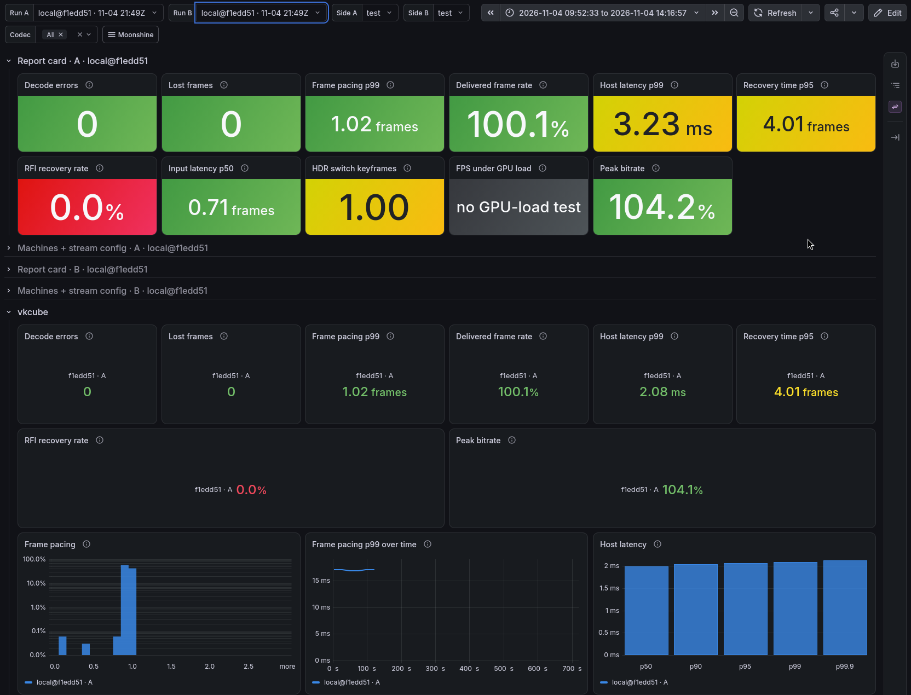

# moonshine-test-headless

Test [Moonshine](https://github.com/hgaiser/moonshine), [pixelforge](https://github.com/hgaiser/pixelforge) and/or
[ferriscope](https://github.com/hgaiser/ferriscope) pull requests on your own hardware with one command. Includes
client telemetry and timing from a simulated Moonlight client (loopback) or one on another machine on your LAN
(SSH), and per-frame trace data. Compare it all in Grafana or in Markdown reports.



## Prerequisites

- Linux with an AMD, Intel or NVIDIA GPU
- [podman](https://podman.io/docs/installation)
- NVIDIA only: the
  [NVIDIA Container Toolkit](https://docs.nvidia.com/datacenter/cloud-native/container-toolkit/latest/cdi-support.html)
  (already on Bazzite and other Universal Blue NVIDIA images; `nvidia-ctk cdi list` shows `nvidia.com/gpu=all` when
  it's set up)

## Quickstart

### Run a test

```sh
podman container runlabel run ghcr.io/porkloin/moonshine-test-headless \
  -- --pixelforge 123
```

On NVIDIA, use `run-nvidia` instead of `run`.

> [!TIP]
> Want results quickly? Use `--tier quick` to run fewer tests.

### View your results

Each run writes its results to a new folder in the current directory:

```
moonshine-test-<timestamp>-<refs>/
```

Open them in a throwaway Grafana:

```sh
podman container runlabel run ghcr.io/porkloin/moonshine-test-headless:view \
  moonshine-test-<timestamp>-<refs>/results.tar.gz
```

It prints a link to open:

```
Open http://localhost:3333/d/moonshine-test-runs?from=1794543900000&to=1794546600000
Ctrl+C to stop; nothing is kept.
```

### Share your benchmark

moonshine-test-headless produces two ways to share your test results with others:

1. **Test summary.** Open or copy `summary.md` inside the results folder, which contains an overview of the test
   results. It's formatted to render in GitHub Markdown, so it can be pasted into a pull request body or comment.
2. **Results bundle.** `results.tar.gz` contains a portable, complete set of metrics and traces. Anyone can open a
   `results.tar.gz` with the view command above to browse every metric and trace from your run.

> [!NOTE]
> Results bundles can get large, and GitHub attachments are limited to 25 MB. Make a smaller copy with the same
> summary:
>
> ```sh
> podman container runlabel compact ghcr.io/porkloin/moonshine-test-headless:view \
>   moonshine-test-<timestamp>-<refs>/results.tar.gz
> ```
>
> If that's still too big, add `--no-traces` to the end of the command. Be aware that `--no-traces` removes all
> trace data from the bundle.

### Compare two runs

```sh
podman container runlabel run ghcr.io/porkloin/moonshine-test-headless:view \
  moonshine-test-<timestamp>-<refs>/results.tar.gz moonshine-test-<timestamp>-<refs>/results.tar.gz
```

The Grafana board opens with the first as run A and the second as run B.

### Make a Markdown report

```sh
podman container runlabel summary ghcr.io/porkloin/moonshine-test-headless:view \
  moonshine-test-<timestamp>-<refs>/results.tar.gz > summary.md
```

Give it a second bundle to put the two runs side by side.

## Loopback, Remote, and Real Clients, and Simulating Network Failures

By default moonshine-test-headless uses a local loopback client via
[gamestream-test-client](https://github.com/porkloin/gamestream-test-client). The loopback client has nearly perfect
network conditions and is unlikely to surface issues that come from network imperfections. Several techniques are
available to test more realistic network conditions:

1. **Loopback client with simulated chaos.** `--chaos` replaces the default packet loss (one frame in 120) on each
   codec's packet-loss stream with any of gamestream-test-client's
   [behavior flags](https://github.com/porkloin/gamestream-test-client#stream-behavior-flags), such as Wi-Fi-style
   bursty loss and jitter. It goes last:

   ```sh
   podman container runlabel run ghcr.io/porkloin/moonshine-test-headless \
     -- --pixelforge 123 --chaos --loss-bursty 2:8 --delay 30:10
   ```

2. **Remote SSH client.** The client runs on another machine over SSH and streams across your real LAN, Wi-Fi or
   Tailscale, decoding on that machine's GPU. That machine needs podman, and SSH asks for its password once:

   ```sh
   podman container runlabel run-remote ghcr.io/porkloin/moonshine-test-headless \
     -- --pixelforge 123 --client you@other-machine
   ```

3. **Real client via LAN/Tailscale.** `serve` builds Moonshine and serves it to a real Moonlight client until Ctrl+C.
   Each workload shows up as an app; pair by typing the PIN Moonlight shows into the terminal. It uses Moonshine's
   default ports, so stop any Moonshine already running on the machine first:

   ```sh
   podman container runlabel serve ghcr.io/porkloin/moonshine-test-headless \
     -- --pixelforge 123
   ```

## Workloads

What gets streamed. `--tier` picks a set; `--app NAME` picks workloads one by one.

| Workload        | Tiers                  | What it tests                                                                 |
| --------------- | ---------------------- | ----------------------------------------------------------------------------- |
| `vkcube`        | quick, standard, full  | A spinning cube with almost no GPU load, so what's measured is Moonshine      |
| `hdrneon-cycle` | standard, full         | Content switching between SDR, HDR10 and scRGB every second, as games do      |
| `clickflash`    | standard, full         | Click-to-photon latency: the screen flashes on each click                     |
| `gravitymark`   | full                   | A GPU stress test that saturates the GPU Moonshine encodes on, like a heavy game |
| `glxgears`      | `--app` only           | Low load through Xwayland, for an X11 app                                     |
| `hdrneon`       | `--app` only           | Bright, saturated motion that keeps the encoder busy, in SDR or HDR10 (`--hdr`) |

GravityMark is downloaded on first use and asks you to accept its license in the terminal, so run `--tier full`
interactively (or pass `--accept-gravitymark-license`).

## Options

Put them after `--`.

- `--moonshine`, `--pixelforge`, `--ferriscope`: what to test of each, at least one:
  - `123`: a pull request on hgaiser's repository
  - `someone@my-branch`: a branch, tag or commit of someone's fork
  - a GitHub link
  - `./pixelforge`: your checkout in the current folder, uncommitted changes included
- `--baseline`: compare against hgaiser's default branches. The baseline is kept, and the next run with the same
  options and machines reuses it instead of building and streaming it again (`--fresh-baseline` to redo it)
- `--calibrate 3`: stream the baseline three times instead of testing, so later `--baseline` runs can say which
  changes are bigger than run-to-run noise. Pass the same refs and options you'll test with
- `--tier quick` or `--tier full`: fewer or more workloads. The standard and full tiers include framestamp, whose every
  frame the client draws again and compares, so corrupt pictures the decoder doesn't report fail the run
- `--iterations N`: timed streams per codec and build with `--baseline` (default 5)
- `--mode 4k120`: stream resolution and frame rate (default `1080p60`)
- `--help`: everything else, also documented in [AGENTS.md](AGENTS.md)

## License

GPL-3.0
